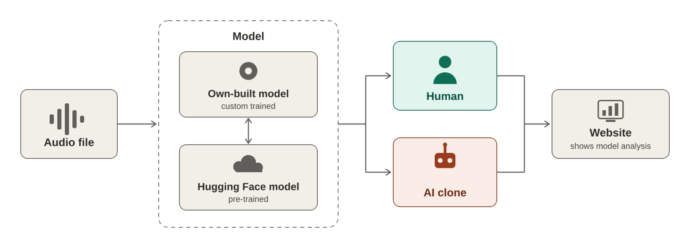

🎙️ Voice Detector

An AI-powered voice detection and audio analysis application built with Flutter and Machine Learning.

Voice Detector is a mobile application developed to provide voice-related detection and audio analysis capabilities. The project combines pre-trained machine learning models from Hugging Face with a custom-trained model developed using a dataset.

📱 Download Voice Detector

Voice Detector is available on the Google Play Store.

Download: "Voice Detector on Google Play Store" (https://play.google.com/store/apps/details?id=com.rahulks.voicedetector)

Package Name: "com.rahulks.voicedetector"

This project demonstrates the practical integration of Artificial Intelligence, Machine Learning, and mobile application development.

🚀 Project Overview

The main objective of Voice Detector is to bring AI-powered voice analysis capabilities into an application through an accessible and user-friendly interface.

I developed this application using Flutter and Dart, integrated pre-trained Hugging Face models, and trained my own machine learning model using a dataset.

##🏗️ System Architecture & Workflow

The following diagram illustrates the overall workflow of Voice Detector, from audio input and model processing to the final analysis displayed on the website.

🔄 How the System Works

1. Audio Input

- The workflow starts with an audio file.
- The audio file is provided as input to the model-processing stage.

2. AI Model Processing

The system includes two model components:

- Own-built Model: A custom machine learning model trained using a dataset.
- Hugging Face Model: A pre-trained model integrated from the Hugging Face ecosystem.

Both model components are connected as shown in the architecture diagram.

3. Analysis Output

The workflow branches into two output categories:

- Human: Human voice-related output.
- AI Clone: AI-generated or cloned voice-related output.

4. Website Integration

The processed analysis is sent to the website, where the model analysis is displayed.

This architecture represents the overall flow from audio input to the final analysis interface.

✨ Features

- Voice detection functionality.
- AI-based audio analysis.
- Integration of pre-trained Hugging Face models.
- Custom-trained machine learning model.
- Recent activity and recording history.
- Live Call Detection usage guide.
- Notification functionality.
- User-friendly dashboard.
- Microphone and permission management.
- Backend integration for audio processing.

Privacy note: The application does not automatically record phone calls. Optional audio recording requires microphone access, and recorded audio can be uploaded to the server for AI analysis.

🧠 Artificial Intelligence & Machine Learning

1. Pre-trained Models

- Integrated pre-trained models from "Hugging Face" (https://huggingface.co/).
- Used existing models for AI-based audio analysis.
- Integrated model functionality into the application.

2. Custom-Trained Model

- Prepared a dataset for model training.
- Trained my own machine learning model.
- Integrated the trained model into the application workflow.
- Connected model outputs with the application and analysis workflow.

Exact model names, model versions, dataset details, and evaluation metrics can be documented here.

🛠️ Technology Stack

Technology| Purpose
Flutter| Mobile application development
Dart| Application programming language
Hugging Face| Pre-trained AI models
Machine Learning| Custom model training
Dataset| Model training and evaluation
Android APIs| Device functionality and permissions
Backend| Audio processing and AI integration
Website| Displaying model analysis

📦 Development Environment & Versions

Component| Version
Flutter| [Add exact version]
Dart| [Add exact version]
Android Gradle Plugin| 8.11.1
Gradle| 8.14.3
Kotlin| 2.2.20
Android SDK| [Add compile SDK version]
Application Version| [Add release version]

Check your actual development environment before publishing these version details.

⚙️ Installation & Setup

Prerequisites

- Flutter SDK
- Dart SDK
- Android Studio
- Git
- Android device or emulator

Clone the Repository

git clone YOUR_GITHUB_REPOSITORY_URL

Navigate to the Project

cd voice_detector

Install Dependencies

flutter pub get

Run the Application

flutter run

📱 Google Play Store

Voice Detector is published on the Google Play Store.

Download: [Add Google Play Store Link]

📸 Screenshots

Add application screenshots here:

- Home Screen
- Dashboard
- Voice Detection Screen
- Recent Activity
- Settings

🎯 What I Learned

Developing this application helped me gain practical experience in:

- Cross-platform mobile application development.
- Integrating pre-trained AI models.
- Preparing datasets and training custom machine learning models.
- Connecting AI functionality with mobile applications.
- Working with Android permissions and notifications.
- Backend integration and audio processing.
- Application testing, debugging, and deployment.

🔮 Future Improvements

- Improve model accuracy and performance.
- Expand audio analysis capabilities.
- Optimize model inference.
- Improve user experience and application performance.

🤝 Contributions

Suggestions, feedback, and contributions are welcome.

If you find this project interesting, feel free to explore the source code and share your feedback.

👨‍💻 Developer

Developed with dedication as a practical project combining Mobile Application Development, Artificial Intelligence, and Machine Learning.

Built with Flutter. Powered by AI. Driven by curiosity.

---

⭐ If you find this project interesting, consider giving the repository a star!.
